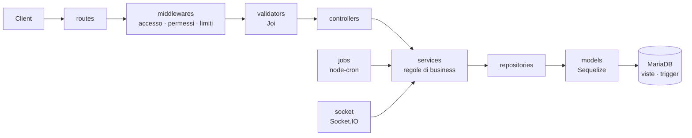

# progettoBE

[English](README.md) · **Italiano** · Client web: [progettoFE](https://github.com/MarcoSabatini98/progettoFE)

API REST e in tempo reale di una piattaforma gestionale white-label per piccoli hotel e B&B.
Una sola installazione fa girare il sito della struttura con la prenotazione online, il
portale dell'ospite e il gestionale dello staff, dalla reception alle pulizie fino agli
adempimenti italiani.

Il client web è **progettoFE** (Angular). Codice, database e messaggi usano nomi di dominio
in italiano (`prenotazioni`, `camere`, `pulizie`...), perché il prodotto è pensato per
l'ospitalità italiana.


---

## Indice

- [Funzionalità](#funzionalità)
- [Tecnologie](#tecnologie)
- [Architettura](#architettura)
- [Avvio rapido](#avvio-rapido)
- [Configurazione](#configurazione)
- [Job pianificati](#job-pianificati)
- [Script](#script)
- [Qualità e test](#qualità-e-test)
- [Sicurezza](#sicurezza)
- [Produzione](#produzione)
- [Struttura del progetto](#struttura-del-progetto)
- [Convenzioni](#convenzioni)
- [Licenza](#licenza)

## Funzionalità

**Prenotazioni e pagamenti**

- Disponibilità in tempo reale, con la camera bloccata per qualche minuto mentre l'ospite
  paga: due ospiti non possono prenotare la stessa camera.
- Motore dei prezzi: piani tariffari, stagioni, promozioni, codici sconto, pacchetti,
  servizi extra e tassa di soggiorno.
- Pagamenti online con checkout ospitato:
  - Stripe: carta, Google Pay, Apple Pay e Klarna, attivati dalla dashboard di Stripe;
  - PayPal;
  - bonifico con scadenza.
- L'ospite paga un acconto o tutto l'importo; il saldo si può pagare in struttura.
- Le prenotazioni incassate oltre il dovuto vengono segnalate allo staff da rimborsare.
- Programma fedeltà a cinque livelli, ognuno con uno sconto percentuale sulle
  prenotazioni.

**Reception e operatività**

- Prenotazioni, ospiti e planning delle camere.
- Check-in online: l'ospite compila i suoi dati prima di arrivare.
- Tabellone delle pulizie:
  - assegnazione automatica delle camere agli addetti, ogni mattina;
  - "prossima camera" su richiesta;
  - checklist e verifica facoltativa della governante.
- Segnalazioni di guasti, che possono mettere una camera fuori servizio e poi rimetterla
  attiva.
- Chat in tempo reale tra ospiti e staff (Socket.IO), con i gruppi dello staff, più le
  notifiche nell'app.
- Statistiche: occupazione, ADR, RevPAR, ricavi per camera e per periodo, e suggerimenti di
  prezzo in base a occupazione ed eventi in zona.
- Registro delle modifiche a prenotazioni, pagamenti e fatture: chi ha cambiato cosa, con i
  valori prima e dopo.

**Canali e adempimenti italiani**

- Sincronizzazione iCal con Booking.com, Airbnb ed Expedia:
  - i calendari esterni diventano date bloccate;
  - ogni camera pubblica il proprio feed di esportazione.
- **Alloggiati Web** (Polizia di Stato): prepara il file delle schedine a tracciato fisso,
  registra gli invii e ricorda alla reception quelle ancora da inviare.
- **Fattura elettronica**: XML FatturaPA e PDF, numerazione fatta dal database e stato
  dello SDI.
- **Tassa di soggiorno**: regole per periodo e riepiloghi mensili.
- Documenti legali con versioni (privacy, condizioni) e preferenze email con
  disiscrizione in un clic.

**Contenuti e white-label**

- Contenuti del sito gestiti dal gestionale: sezioni delle pagine, galleria, FAQ, eventi in
  zona e recensioni verificate con moderazione.
- Contenuti tradotti in cinque lingue (it, en, fr, de, es).
- Brand e impostazioni della struttura (nome, logo, colori, regole) salvati nel database.
  Niente è scritto nel codice per un singolo cliente.
- Cinque ruoli con permessi configurabili: admin, receptionist, governante, addetto alle
  pulizie e cliente.

## Tecnologie

| Area        | Scelta                                                                            |
| ----------- | --------------------------------------------------------------------------------- |
| Runtime     | Node.js ≥ 22, Express                                                             |
| Database    | MariaDB / MySQL, ORM Sequelize; schema con viste, trigger e routine               |
| Accesso     | Access token JWT + refresh token a rotazione in cookie httpOnly, bcrypt           |
| Tempo reale | Socket.IO                                                                         |
| Pagamenti   | Stripe Checkout, PayPal Orders API                                                |
| Job         | node-cron                                                                         |
| Altro       | Validazione Joi, Helmet, express-rate-limit, Multer, Nodemailer, pdfmake, Winston |
| Qualità     | Jest, ESLint, Prettier, Husky + lint-staged                                       |

## Architettura



- I **controller** leggono la richiesta e mandano la risposta, nient'altro. I **service**
  contengono le regole di business. I **repository** sono l'unico livello che interroga il
  database.
- Un modello per file e niente SQL scritto a mano con input dell'utente.
- Le regole di integrità che non devono mai essere aggirate stanno nel database:
  disponibilità e capienza delle camere, numerazione delle fatture senza buchi, utilizzi
  dei codici sconto, punti fedeltà al check-out e registro delle modifiche. Così valgono
  qualunque sia il codice che scrive i dati.
- Le integrazioni facoltative (SMTP, Stripe, PayPal) si accendono quando le loro variabili
  sono compilate. Senza SMTP le email finiscono nel log.

## Avvio rapido

### Requisiti

- Node.js 22 o più recente (consigliato il 24, come progettoFE)
- MariaDB 10.6+ o MySQL 8.0.16+
- Facoltativo: [ngrok](https://ngrok.com/), per ricevere in locale i webhook di PayPal

### Installazione

```bash
git clone <url-del-repository> progettoBE
cd progettoBE
npm install
cp .env.example .env   # poi compila i valori (vedi Configurazione)
```

### Database

```bash
npm run db:create   # crea il database (utf8mb4)
npm run migrate     # tabelle, viste, trigger, ruoli, permessi, impostazioni
npm run seed        # primo admin + dati di prova (in produzione i dati di prova no)
```

Il seed di prova ricrea una struttura che usa l'app da due anni. Contiene staff e ospiti,
soggiorni passati, in corso e futuri, fatture, pagamenti, chat, pulizie e contenuti in
cinque lingue. La password comune degli account di prova viene stampata alla fine di
`npm run seed`.

`npm run db:reset` cancella e ricostruisce tutto. Con `NODE_ENV=production` si rifiuta di
partire.

### Avvio

```bash
npm run dev     # watch + tunnel ngrok se disponibile
npm start       # semplice node server.js
```

| Servizio         | URL                                |
| ---------------- | ---------------------------------- |
| API              | http://localhost:3000/api          |
| Media            | http://localhost:3000/media        |
| Controllo salute | http://localhost:3000/salute       |
| Frontend         | http://localhost:4200 (progettoFE) |

## Configurazione

Tutto si legge da `.env` e viene validato una volta sola all'avvio con Joi. Se manca
qualcosa o è sbagliato, il server non parte e dice cosa correggere. `.env.example` spiega
ogni variabile.

| Gruppo     | Variabili                                                                                                              | Note                                                                       |
| ---------- | ---------------------------------------------------------------------------------------------------------------------- | -------------------------------------------------------------------------- |
| App        | `NODE_ENV`, `PORT`, `APP_URL`, `FRONTEND_URL`, `PROXY_FIDATI`, `LOG_LEVEL`                                             | `APP_URL` serve per email, webhook e feed iCal; `FRONTEND_URL` per il CORS |
| Database   | `DB_HOST`, `DB_PORT`, **`DB_NAME`**, **`DB_USER`**, `DB_PASSWORD`, `DB_POOL_MAX`, `DB_LOG`                             |                                                                            |
| Accesso    | **`JWT_ACCESS_SECRET`**, **`JWT_REFRESH_SECRET`**, **`JWT_CHAT_SECRET`**, `JWT_ACCESS_DURATA`, `REFRESH_DURATA_GIORNI` | Segreti: almeno 32 caratteri, tutti diversi                                |
| Upload     | `UPLOAD_DIR`, `UPLOAD_MAX_MB`, `UPLOAD_VIDEO_MAX_MB`                                                                   | `UPLOAD_DIR` va su uno spazio persistente                                  |
| Email      | `SMTP_HOST`, `SMTP_PORT`, `SMTP_SECURE`, `SMTP_USER`, `SMTP_PASSWORD`, `MAIL_MITTENTE`                                 | Facoltative: senza SMTP le email finiscono nel log                         |
| Stripe     | `STRIPE_SECRET_KEY`, `STRIPE_WEBHOOK_SECRET`                                                                           | Con la chiave compilata, il segreto del webhook diventa obbligatorio       |
| PayPal     | `PAYPAL_AMBIENTE`, `PAYPAL_CLIENT_ID`, `PAYPAL_CLIENT_SECRET`, `PAYPAL_WEBHOOK_ID`                                     | Con il segreto compilato, l'ID del webhook diventa obbligatorio            |
| Alloggiati | `ALLOGGIATI_UTENTE`, `ALLOGGIATI_PASSWORD`, `ALLOGGIATI_WSKEY`                                                         | Credenziali del portale della Polizia                                      |
| Seed       | `SEED_ADMIN_EMAIL`, `SEED_ADMIN_PASSWORD`, `SEED_ADMIN_NOME`, `SEED_ADMIN_COGNOME`, `SEED_STRUTTURA_NOME`              | Primo admin, creato solo se non ne esiste già uno                          |

Le variabili in **grassetto** sono obbligatorie. Per generare un segreto:

```bash
node -e "console.log(require('crypto').randomBytes(48).toString('base64url'))"
```

Webhook da registrare presso i provider:

| Provider | URL                                      | Eventi                                                                                                                                        |
| -------- | ---------------------------------------- | --------------------------------------------------------------------------------------------------------------------------------------------- |
| Stripe   | `<APP_URL>/api/pagamenti/webhook/stripe` | `checkout.session.completed`, `checkout.session.async_payment_succeeded`, `checkout.session.async_payment_failed`, `checkout.session.expired` |
| PayPal   | `<APP_URL>/api/pagamenti/webhook/paypal` | `CHECKOUT.ORDER.APPROVED`, `PAYMENT.CAPTURE.COMPLETED`, `PAYMENT.CAPTURE.DENIED`                                                              |

## Job pianificati

I job girano dentro il processo dell'API ([src/jobs/index.js](src/jobs/index.js)), con il
fuso orario della struttura. Un job salta il giro se quello precedente è ancora in corso.
Un errore finisce nel log e non ferma gli altri job.

| Job                                                  | Quando         | Cosa fa                                                               |
| ---------------------------------------------------- | -------------- | --------------------------------------------------------------------- |
| `blocchi-scaduti`                                    | ogni 5 minuti  | Libera le camere bloccate da pagamenti online mai conclusi            |
| `prenotazioni-scadute`                               | ogni 10 minuti | Cancella le prenotazioni in attesa non pagate entro la scadenza       |
| `pagamenti-abbandonati`                              | ogni ora       | Annulla i pagamenti online iniziati e fermi da 24 ore                 |
| `riepiloghi-chat`                                    | ogni 5 minuti  | Email a chi ha messaggi della chat non letti                          |
| `calendari-esterni`                                  | ogni 15 minuti | Importa i calendari iCal di Booking, Airbnb ed Expedia                |
| `pulizie-giornata`                                   | 6:00           | Riporta le pulizie non finite, crea e assegna quelle del giorno       |
| `rimborsi-dovuti`                                    | 9:00           | Avvisa delle prenotazioni incassate oltre il dovuto (da rimborsare)   |
| `alloggiati-promemoria`                              | 9:00           | Avvisa delle schedine Alloggiati ancora da inviare                    |
| `fatture-sdi`                                        | 9:30           | Avvisa delle fatture non ancora inviate allo SDI o scartate           |
| `tassa-in-scadenza`                                  | 9:30           | Avvisa se le regole della tassa di soggiorno finiscono senza seguito  |
| `promemoria-checkin`                                 | 10:00          | Promemoria agli ospiti che arrivano domani                            |
| `prenotazioni-dimenticate`                           | 13:00          | No-show per gli arrivi mancati, chiude le partenze dei giorni passati |
| `invito-recensione`                                  | 17:00          | Invita a lasciare una recensione chi è partito ieri                   |
| `notifiche-vecchie`, `chat-vecchie`, `token-scaduti` | 3:00–4:00      | Eliminano notifiche lette vecchie, chat chiuse e token scaduti        |

## Script

| Comando                               | Cosa fa                                            |
| ------------------------------------- | -------------------------------------------------- |
| `npm run dev`                         | Server in watch, più un tunnel ngrok per i webhook |
| `npm start`                           | Avvio di produzione                                |
| `npm test`                            | Test unitari, poi test di integrazione             |
| `npm run test:unit` / `test:coverage` | Solo test unitari / con report di copertura        |
| `npm run lint` / `lint:fix`           | ESLint                                             |
| `npm run format` / `format:check`     | Prettier                                           |
| `npm run db:create` / `db:reset`      | Crea / ricostruisce il database                    |
| `npm run migrate` / `migrate:status`  | Applica / elenca le migrazioni                     |
| `npm run seed`                        | Primo admin e dati di prova                        |

## Qualità e test

- **263 test unitari** (Jest) coprono service, validatori, middleware, job e utility.
- Hook git: `lint-staged` al commit; `npm run lint` e `npm test` al push.
- La formattazione Prettier ed ESLint vengono controllati a ogni commit.

## Sicurezza

Il progetto segue l'OWASP Top 10, l'OWASP API Security Top 10 e le indicazioni di sicurezza
di Stripe e PayPal.

- **Accesso**
  - Access token di breve durata (solo HS256).
  - Refresh token in cookie httpOnly, rinnovato a ogni uso. Il riuso di un token vecchio
    revoca tutta la sua famiglia.
  - Hash bcrypt, con lo stesso tempo di risposta anche per le email inesistenti, così gli
    account non si possono scoprire per tentativi.
- **Limiti contro gli abusi**
  - Limiti di richieste per IP e per account.
  - Protezione dai tentativi ripetuti di accesso.
  - Rallentamento delle richieste di scrittura.
  - Timeout su richieste e header contro gli attacchi slow-loris.
- **Input**
  - Validazione Joi su ogni rotta.
  - Query parametrizzate di Sequelize.
  - Body JSON limitato a 1 MB.
  - Upload controllati dai magic byte, non dall'estensione.
- **Pagamenti**
  - Gli importi si calcolano solo sul server.
  - Le firme dei webhook vengono verificate.
  - Le catture sono idempotenti.
  - I dati della carta non passano mai dal server, perché il checkout è ospitato
    (PCI DSS SAQ A).
- **Header**
  - Helmet.
  - CORS stretto su `FRONTEND_URL`.
  - `Cache-Control: no-store` sull'API.
  - `PROXY_FIDATI`, così l'IP del client si legge bene dietro un proxy.

La protezione dai DDoS a livello di rete spetta al reverse proxy o alla CDN davanti
all'app, per esempio Cloudflare.

## Produzione

Questa è una traccia generica. Verrà completata con il primo deploy reale.

1. **Server.** Node.js 24 e MariaDB, su un hosting gestito o su una VPS. Va avviata
   **una sola istanza**: i job girano nel processo, quindi con più istanze ognuna
   eseguirebbe ogni job.
2. **Ambiente.**
   - Imposta `NODE_ENV=production`, `APP_URL` e `FRONTEND_URL` reali, segreti robusti e
     l'SMTP.
   - Per i pagamenti online servono anche le variabili di Stripe e PayPal.
   - Imposta `PROXY_FIDATI` con il numero di proxy davanti all'app.
3. **Database.** Esegui `npm ci --omit=dev`, poi `npm run migrate` e `npm run seed`. In
   produzione il seed crea solo il primo admin e i dati di base, mai i dati di prova.
4. **Reverse proxy con HTTPS.** progettoFE e l'API vanno sullo stesso dominio:
   - `/api`, `/media` e `/socket.io` (con l'upgrade WebSocket) vanno all'API;
   - tutti gli altri percorsi vanno alla build del frontend, con ritorno a `index.html`.
5. **File.** Tieni `UPLOAD_DIR` su uno spazio persistente e mettilo nei backup insieme al
   database.
6. **Integrazioni.**
   - Registra i webhook di Stripe e PayPal (vedi Configurazione).
   - Dai ai portali (Booking, Airbnb...) l'URL di esportazione iCal di ogni camera.
7. **Monitoraggio.** Un controllo di uptime su `/salute`. I log di Winston vanno su
   stdout.

## Struttura del progetto

```
app.js / server.js     app Express, server HTTP, avvio di Socket.IO e dei job
database/
  schema.sql           schema completo: tabelle, viste, trigger, routine, ruoli, impostazioni
  migrations/          migrazioni Sequelize (la prima carica schema.sql)
  seeders/ seed-prova/ primo admin + dati di prova realistici
  dati/                dati di riferimento (comuni, stati e documenti Alloggiati) e media di prova
scripts/sviluppo.js    server di sviluppo con tunnel ngrok
src/
  config/              env validato, database, logger
  constants/           enum e codici condivisi con il frontend
  routes/              un router per dominio
  middlewares/         accesso, permessi, limiti, upload, errori
  validators/          schemi Joi per rotta
  controllers/         solo ingresso e uscita HTTP
  services/            logica di business
  repositories/        accesso ai dati
  models/              un modello Sequelize per file
  jobs/                attività pianificate (solo l'orario; la logica sta nei service)
  socket/              chat e notifiche in tempo reale
  utils/               date, importi, PDF, client Stripe/PayPal, paginazione
tests/unit/            test Jest
```

## Convenzioni

- **Lingua.** Il dominio è in italiano: file, funzioni, colonne e campi dell'API. I codici
  di errore sono costanti stabili (per esempio `SINCRONIZZAZIONE_FALLITA`) che il frontend
  traduce.
- **Commit.** I messaggi seguono Conventional Commits in italiano, per esempio
  `feat(pulizie): ...` o `fix(seed): ...`.
- **Branch.** Si lavora su branch `feat/*`, `fix/*` e `docs/*`. Ognuno entra in `develop`
  con una pull request, e `main` contiene i rilasci.
- **Risposte dell'API.** Ogni risposta ha la stessa forma (`src/utils/risposta.js`). Gli
  elenchi sono paginati con `src/utils/paginazione.js`.

## Licenza

Software proprietario. Copyright © 2026 Marco Sabatini. Tutti i diritti riservati. Vedi
[LICENSE](LICENSE).
