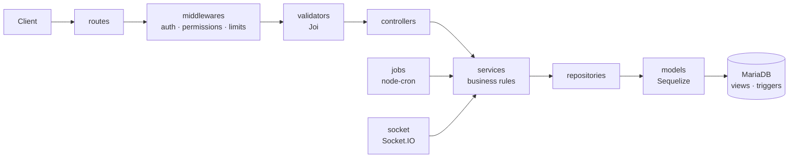

# progettoBE

**English** · [Italiano](README.it.md)

REST and real-time API behind a white-label management platform for small hotels and B&Bs.
A single installation runs the property's public website and online booking, the guest
portal, and the staff back office, from front desk to housekeeping and Italian compliance.

The web client lives in **progettoFE** (Angular). Code, database and messages use Italian
domain names (`prenotazioni`, `camere`, `pulizie`...), because the product targets Italian
hospitality.


---

## Contents

- [Features](#features)
- [Tech stack](#tech-stack)
- [Architecture](#architecture)
- [Getting started](#getting-started)
- [Configuration](#configuration)
- [Scheduled jobs](#scheduled-jobs)
- [Scripts](#scripts)
- [Quality and testing](#quality-and-testing)
- [Security](#security)
- [Production](#production)
- [Project structure](#project-structure)
- [Conventions](#conventions)
- [License](#license)

## Features

**Booking and payments**

- Real-time availability with temporary holds while the guest checks out, so two guests
  can't book the same room.
- Pricing engine: rate plans, seasons, promotions, discount codes, packages, extra
  services and city tax.
- Online payments through hosted checkout:
  - Stripe: cards, Google Pay, Apple Pay and Klarna, enabled from the Stripe dashboard;
  - PayPal;
  - bank transfer with a payment deadline.
- The guest pays a deposit or the full amount; the balance can be paid at the property.
- Overpayments to refund are flagged to staff.
- Loyalty programme with five tiers, each giving a percentage discount on bookings.

**Front desk and operations**

- Bookings, guests and room planning.
- Online check-in: guests fill in their own details before they arrive.
- Housekeeping board:
  - automatic daily assignment of rooms to housekeepers;
  - "next room" on demand;
  - checklists and optional inspection by a senior housekeeper.
- Maintenance tickets that can take a room out of service and put it back afterwards.
- Real-time chat between guests and staff (Socket.IO), with staff groups, plus in-app
  notifications.
- Analytics: occupancy, ADR, RevPAR, revenue per room and per period, and pricing
  suggestions based on occupancy and local events.
- Audit log of changes to bookings, payments and invoices: who changed what, and the
  values before and after.

**Channels and compliance (Italy)**

- iCal sync with Booking.com, Airbnb and Expedia:
  - external calendars become blocked dates;
  - every room publishes its own export feed.
- **Alloggiati Web** (Polizia di Stato): builds the fixed-width guest-record file, tracks
  submissions and reminds staff of records that are due.
- **Electronic invoicing**: FatturaPA XML and PDF, numbering done by the database, and
  tracking of SDI status.
- **City tax**: rules by period and monthly summaries.
- Versioned legal documents (privacy policy, terms) and email preferences with one-click
  unsubscribe.

**Content and white-label**

- Public website content managed from the back office: page sections, gallery, FAQ,
  local events and verified reviews with moderation.
- Content translated into five languages (it, en, fr, de, es).
- Branding and property settings (name, logo, colours, policies) stored in the database.
  Nothing is hard-coded per customer.
- Five roles with configurable permissions: admin, receptionist, senior housekeeper,
  housekeeper and guest.

## Tech stack

| Area      | Choice                                                                           |
| --------- | -------------------------------------------------------------------------------- |
| Runtime   | Node.js ≥ 22, Express                                                            |
| Database  | MariaDB / MySQL, Sequelize ORM; schema with views, triggers and stored routines  |
| Auth      | JWT access token + rotating refresh token in an httpOnly cookie, bcrypt          |
| Real time | Socket.IO                                                                        |
| Payments  | Stripe Checkout, PayPal Orders API                                               |
| Jobs      | node-cron                                                                        |
| Other     | Joi validation, Helmet, express-rate-limit, Multer, Nodemailer, pdfmake, Winston |
| Quality   | Jest, ESLint, Prettier, Husky + lint-staged                                      |

## Architecture



- **Controllers** only read the request and send the response. **Services** hold the
  business rules. **Repositories** are the only layer that queries the database.
- There is one model per file and no raw SQL with user input.
- Integrity rules that must never be bypassed live in the database: room availability and
  capacity, gap-free invoice numbering, discount-code usage, loyalty points at check-out
  and the audit log. That way they hold whichever code path writes the data.
- Optional integrations (SMTP, Stripe, PayPal) switch on when their variables are set.
  Without SMTP, emails are written to the log.

## Getting started

### Prerequisites

- Node.js 22 or newer (24 recommended, the same as progettoFE)
- MariaDB 10.6+ or MySQL 8.0.16+
- Optional: [ngrok](https://ngrok.com/), to receive PayPal webhooks locally

### Install

```bash
git clone <repository-url> progettoBE
cd progettoBE
npm install
cp .env.example .env   # then fill in the values (see Configuration)
```

### Database

```bash
npm run db:create   # creates the database (utf8mb4)
npm run migrate     # tables, views, triggers, roles, permissions, settings
npm run seed        # first admin + demo data (demo data is skipped in production)
```

The demo seed recreates a property that has used the app for two years. It includes
staff and guests, past, current and future stays, invoices, payments, chats, housekeeping
and content in five languages. The shared password of the demo accounts is printed at the
end of `npm run seed`.

`npm run db:reset` drops and rebuilds everything. It refuses to run with
`NODE_ENV=production`.

### Run

```bash
npm run dev     # watch mode + ngrok tunnel when available
npm start       # plain node server.js
```

| Service      | URL                                |
| ------------ | ---------------------------------- |
| API          | http://localhost:3000/api          |
| Media        | http://localhost:3000/media        |
| Health check | http://localhost:3000/salute       |
| Frontend     | http://localhost:4200 (progettoFE) |

## Configuration

Everything is read from `.env` and validated once at startup with Joi. If something is
missing or wrong, the server doesn't start and lists what to fix. `.env.example` documents
each variable.

| Group      | Variables                                                                                                              | Notes                                                                            |
| ---------- | ---------------------------------------------------------------------------------------------------------------------- | -------------------------------------------------------------------------------- |
| App        | `NODE_ENV`, `PORT`, `APP_URL`, `FRONTEND_URL`, `PROXY_FIDATI`, `LOG_LEVEL`                                             | `APP_URL` is used in emails, webhooks and iCal feeds; `FRONTEND_URL` drives CORS |
| Database   | `DB_HOST`, `DB_PORT`, **`DB_NAME`**, **`DB_USER`**, `DB_PASSWORD`, `DB_POOL_MAX`, `DB_LOG`                             |                                                                                  |
| Auth       | **`JWT_ACCESS_SECRET`**, **`JWT_REFRESH_SECRET`**, **`JWT_CHAT_SECRET`**, `JWT_ACCESS_DURATA`, `REFRESH_DURATA_GIORNI` | Secrets: at least 32 characters, all different                                   |
| Uploads    | `UPLOAD_DIR`, `UPLOAD_MAX_MB`, `UPLOAD_VIDEO_MAX_MB`                                                                   | Keep `UPLOAD_DIR` on persistent storage                                          |
| Email      | `SMTP_HOST`, `SMTP_PORT`, `SMTP_SECURE`, `SMTP_USER`, `SMTP_PASSWORD`, `MAIL_MITTENTE`                                 | Optional: without SMTP, emails go to the log                                     |
| Stripe     | `STRIPE_SECRET_KEY`, `STRIPE_WEBHOOK_SECRET`                                                                           | The webhook secret becomes required once the key is set                          |
| PayPal     | `PAYPAL_AMBIENTE`, `PAYPAL_CLIENT_ID`, `PAYPAL_CLIENT_SECRET`, `PAYPAL_WEBHOOK_ID`                                     | The webhook ID becomes required once the secret is set                           |
| Alloggiati | `ALLOGGIATI_UTENTE`, `ALLOGGIATI_PASSWORD`, `ALLOGGIATI_WSKEY`                                                         | Police portal credentials                                                        |
| Seed       | `SEED_ADMIN_EMAIL`, `SEED_ADMIN_PASSWORD`, `SEED_ADMIN_NOME`, `SEED_ADMIN_COGNOME`, `SEED_STRUTTURA_NOME`              | First admin, created only if none exists                                         |

**Bold** variables are required. To generate a secret:

```bash
node -e "console.log(require('crypto').randomBytes(48).toString('base64url'))"
```

Webhook endpoints to register with the providers:

| Provider | URL                                      | Events                                                                                                                                        |
| -------- | ---------------------------------------- | --------------------------------------------------------------------------------------------------------------------------------------------- |
| Stripe   | `<APP_URL>/api/pagamenti/webhook/stripe` | `checkout.session.completed`, `checkout.session.async_payment_succeeded`, `checkout.session.async_payment_failed`, `checkout.session.expired` |
| PayPal   | `<APP_URL>/api/pagamenti/webhook/paypal` | `CHECKOUT.ORDER.APPROVED`, `PAYMENT.CAPTURE.COMPLETED`, `PAYMENT.CAPTURE.DENIED`                                                              |

## Scheduled jobs

Jobs run inside the API process ([src/jobs/index.js](src/jobs/index.js)) on the property's
time zone. A job is skipped if its previous run is still going. An error is logged and
doesn't stop the other jobs.

| Job                                                  | When         | What it does                                                          |
| ---------------------------------------------------- | ------------ | --------------------------------------------------------------------- |
| `blocchi-scaduti`                                    | every 5 min  | Frees rooms held by online payments that were never completed         |
| `prenotazioni-scadute`                               | every 10 min | Cancels pending bookings not paid by their deadline                   |
| `pagamenti-abbandonati`                              | hourly       | Cancels online payments left unfinished for 24 hours                  |
| `riepiloghi-chat`                                    | every 5 min  | Emails users who have unread chat messages                            |
| `calendari-esterni`                                  | every 15 min | Imports Booking/Airbnb/Expedia iCal calendars                         |
| `pulizie-giornata`                                   | 06:00        | Carries over unfinished cleaning, creates and assigns the day's tasks |
| `rimborsi-dovuti`                                    | 09:00        | Warns staff about bookings paid more than owed (to refund)            |
| `alloggiati-promemoria`                              | 09:00        | Reminds staff of guest records still to send to Alloggiati Web        |
| `fatture-sdi`                                        | 09:30        | Warns about invoices not yet sent to SDI, or rejected                 |
| `tassa-in-scadenza`                                  | 09:30        | Warns when the city-tax rules run out with nothing after them         |
| `promemoria-checkin`                                 | 10:00        | Reminds guests arriving tomorrow                                      |
| `prenotazioni-dimenticate`                           | 13:00        | Marks missed arrivals as no-shows, closes past departures             |
| `invito-recensione`                                  | 17:00        | Invites guests who left yesterday to leave a review                   |
| `notifiche-vecchie`, `chat-vecchie`, `token-scaduti` | 03:00–04:00  | Delete old read notifications, closed chats and expired tokens        |

## Scripts

| Command                               | What it does                                            |
| ------------------------------------- | ------------------------------------------------------- |
| `npm run dev`                         | Server in watch mode, plus an ngrok tunnel for webhooks |
| `npm start`                           | Production start                                        |
| `npm test`                            | Unit tests, then integration tests                      |
| `npm run test:unit` / `test:coverage` | Unit tests only / with coverage report                  |
| `npm run lint` / `lint:fix`           | ESLint                                                  |
| `npm run format` / `format:check`     | Prettier                                                |
| `npm run db:create` / `db:reset`      | Create / rebuild the database                           |
| `npm run migrate` / `migrate:status`  | Apply / list migrations                                 |
| `npm run seed`                        | First admin and demo data                               |

## Quality and testing

- **263 unit tests** (Jest) cover services, validators, middlewares, jobs and utilities.
- Git hooks: `lint-staged` on commit; `npm run lint` and `npm test` on push.
- Prettier formatting and ESLint are enforced on every commit.

## Security

The design follows the OWASP Top 10, the OWASP API Security Top 10, and the security
guidance of Stripe and PayPal.

- **Auth**
  - Short-lived access token (HS256 only).
  - Refresh token in an httpOnly cookie, rotated on every use. Reusing an old one revokes
    the whole token family.
  - bcrypt hashing, with the same response time for unknown emails so accounts can't be
    enumerated.
- **Abuse limits**
  - Rate limits per IP and per account.
  - Brute-force protection on login.
  - Throttling of write requests.
  - Request and header timeouts against slow-loris attacks.
- **Input**
  - Joi validation on every route.
  - Sequelize parameterised queries.
  - 1 MB JSON body limit.
  - Uploads checked by their magic bytes, not by extension.
- **Payments**
  - Amounts are computed only on the server.
  - Webhook signatures are verified.
  - Captures are idempotent.
  - Card data never touches the server, because checkout is hosted (PCI DSS SAQ A).
- **Headers**
  - Helmet.
  - Strict CORS on `FRONTEND_URL`.
  - `Cache-Control: no-store` on the API.
  - `PROXY_FIDATI`, so client IPs are read correctly behind a proxy.

Network-level DDoS protection is the job of the reverse proxy or CDN in front of the app,
for example Cloudflare.

## Production

This is a generic outline. It will be expanded with the first real deployment.

1. **Server.** Node.js 24 and MariaDB on a managed host or a VPS. Run **one instance**:
   jobs run in-process, so several instances would each run every job.
2. **Environment.**
   - Set `NODE_ENV=production`, real `APP_URL` and `FRONTEND_URL`, strong secrets, and
     SMTP.
   - For online payments, also set the Stripe and PayPal variables.
   - Set `PROXY_FIDATI` to the number of proxies in front of the app.
3. **Database.** Run `npm ci --omit=dev`, then `npm run migrate` and `npm run seed`. In
   production the seed creates only the first admin and the base data, never demo data.
4. **Reverse proxy with HTTPS.** Serve progettoFE and the API on the same domain:
   - `/api`, `/media` and `/socket.io` (with WebSocket upgrade) go to the API;
   - every other path goes to the frontend build, falling back to `index.html`.
5. **Files.** Keep `UPLOAD_DIR` on persistent storage and include it in backups together
   with the database.
6. **Integrations.**
   - Register the Stripe and PayPal webhooks (see Configuration).
   - Point the OTA channel managers at each room's iCal export URL.
7. **Monitoring.** Point an uptime check at `/salute`. Winston logs go to stdout.

## Project structure

```
app.js / server.js     Express app, HTTP server, Socket.IO and jobs startup
database/
  schema.sql           full schema: tables, views, triggers, routines, roles, settings
  migrations/          Sequelize migrations (the first one loads schema.sql)
  seeders/ seed-prova/ first admin + realistic demo data
  dati/                reference data (Alloggiati towns, countries, documents) and demo media
scripts/sviluppo.js    dev server with ngrok tunnel
src/
  config/              validated env, database, logger
  constants/           enums and codes shared with the frontend
  routes/              one router per domain
  middlewares/         auth, permissions, rate limits, uploads, errors
  validators/          Joi schemas per route
  controllers/         HTTP in and out only
  services/            business logic
  repositories/        data access
  models/              one Sequelize model per file
  jobs/                scheduled tasks (schedule only; logic lives in services)
  socket/              real-time chat and notifications
  utils/               dates, money, PDF, Stripe/PayPal clients, pagination
tests/unit/            Jest tests
```

## Conventions

- **Language.** The domain is Italian: files, functions, columns and API fields. Error
  codes are stable constants (for example `SINCRONIZZAZIONE_FALLITA`) that the frontend
  translates.
- **Commits.** Commit messages follow Conventional Commits in Italian, for example
  `feat(pulizie): ...` or `fix(seed): ...`.
- **Branches.** Work happens on `feat/*`, `fix/*` and `docs/*` branches. Each one is
  merged into `develop` through a pull request, and `main` holds releases.
- **API responses.** Every response has the same shape (`src/utils/risposta.js`). Lists are
  paginated through `src/utils/paginazione.js`.

## License

Proprietary software. Copyright © 2026 Marco Sabatini. All rights reserved. See
[LICENSE](LICENSE).
